제목: [시안] 혁신 아이디어 시안 GIF 11개 (11/7)
카테고리: ideas
---
> 11/7 새벽 혁신 아이디어 토너먼트(200개 → 상위 10개 → 최종 1개) 결과를 움직이는 화면으로 만든 **시안**이에요. 아직 정한 게 아니고, 요구사항·코드는 바꾸지 않았어요. 보고 의견을 댓글로 남겨 주세요.
> GIF가 11개라 모바일 데이터로는 40MB쯤 써요. 와이파이에서 열어 주세요.

## 최종 추천: 말 한 마디로 시작하는 빈방 릴레이

학생이 들은 공지를 말하거나 붙여 넣기만 하면, AI가 휴강·보강으로 읽고 겹친 예약을 먼저 짚어 줘요. 놓아준 방은 기다리던 학생에게 바로 가요. 문 장치가 틀려서 생긴 노쇼는 방이 먼저 무르고 사과해요.

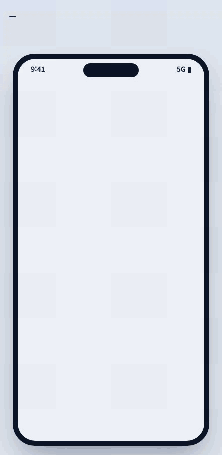

- 사람 손은 탭 3번, 교학팀 0명. 최종 5개 중 1번 "빈방 릴레이"에 붙이는 안이에요.
- AI가 꼭 필요한 곳은 **사람이 쓴 공지·말을 읽는 한 곳뿐**이에요. 나머지는 규칙이 해요.
- 솔직하게: 엄격한 검증을 끝까지 통과한 아이디어는 없었어요. 이건 세 번의 검증에서 살아남은 조각을 묶은 안이라, 11/9 설문 문항 추가와 11/10 공지 30건 비교 시험(정규식 vs Gemini)으로 확인한 뒤 팀이 정해요.

---

## 상위 10개 시안

순위 1–6은 결승 점수, 7–10은 준결승 평균 점수예요.

### 1위. 학생 편 변호사 비서
문이 잠겨 못 들어간 학생 대신 비서가 먼저 기록에서 근거를 찾아요. 기록이 확실하면 규칙이 바로 풀고, 애매한 것만 근거를 붙여 관리자에게 보내요.

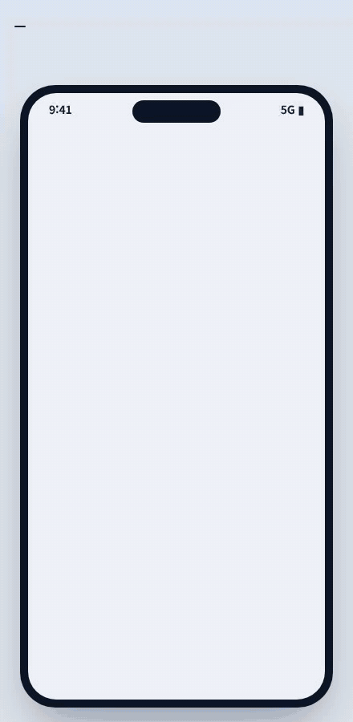

### 2위. 오판하면 방이 먼저 사과
방이 "비었다"고 잘못 판단했으면 3분 뒤 스스로 다시 보고 먼저 사과해요. 탭 한 번에 남은 시간이 돌아오고, 오판도 숨기지 않고 숫자로 쌓여요.

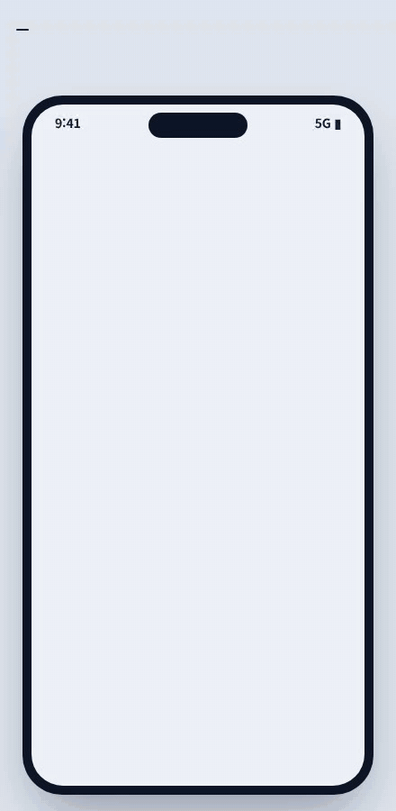

### 3위. 아픈 방은 스스로 쉰다
문 장치가 고장 난 방은 스스로 쉬고, 예약한 학생은 출발 전에 알림을 받아 탭 한 번에 옆방으로 옮겨요. 벌점은 없어요.

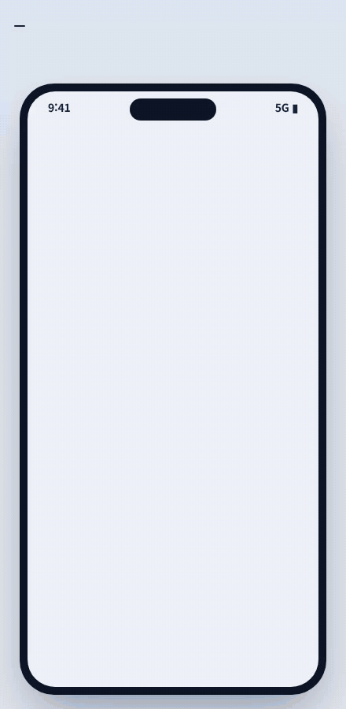

### 4위. 교학팀 퇴근 인계, 밤에도 답해요
17:30에 비서가 교학팀에게 버튼 세 번으로 오늘 밤 판단을 받아 두고, 밤에 학생이 물으면 그 말을 시각과 함께 인용해 답해요.

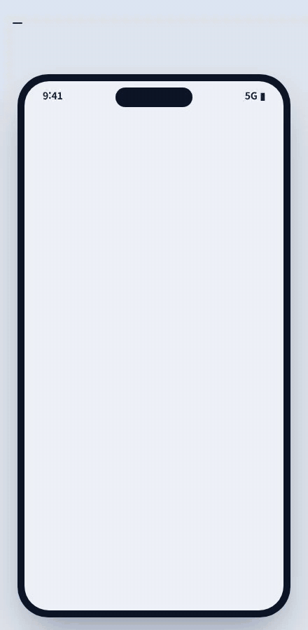

### 5위. 억울한 노쇼, 비서가 먼저 해명
문 앞에서 QR이 막혀 노쇼가 됐으면 벌보다 비서 설명이 먼저 와요. 기록에서 근거를 찾아 초안을 쓰고, 관리자는 근거를 보고 탭 한 번이면 돼요.

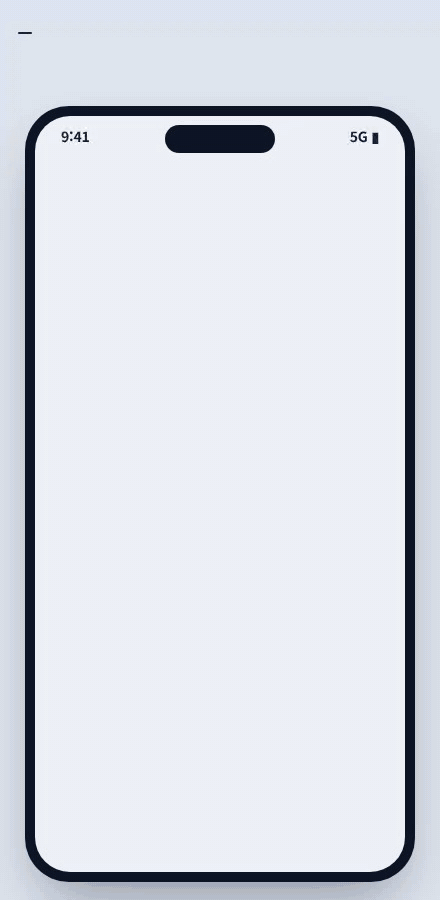

### 6위. 단톡 공지 공유, 비서가 먼저
단톡방 휴강 공지를 M-space로 넘기면 비서가 날짜로 읽고, 겹친 예약을 먼저 짚어 탭 한 번에 휴강 시간으로 옮겨요.

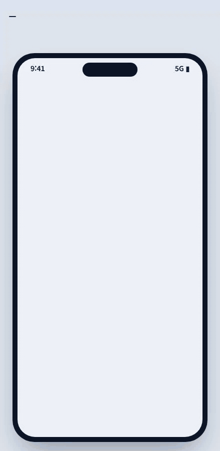

### 7위. 위임장 비서: 다음 예약
조건을 한 번만 말해 두면, 퇴실하자마자 비서가 다음 예약을 잡고 그 시간에 QR을 먼저 내밀어요.

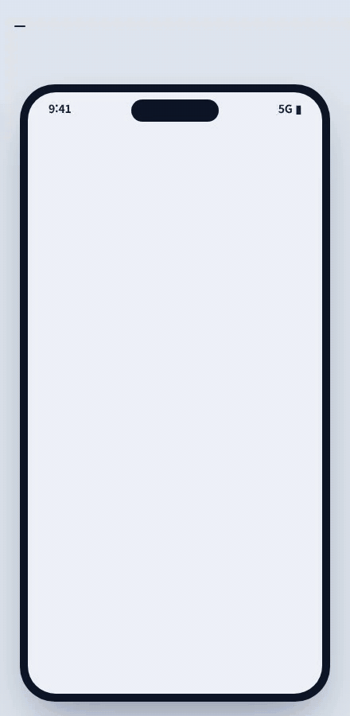

### 8위. 답 못 한 질문 수확
규칙에 없는 질문이 오면 모아 뒀다가 교학팀에 한 줄 답을 청하고, 물었던 학생에게 먼저 알려 줘요. 다음 학생부터는 근거를 붙여 바로 답해요.

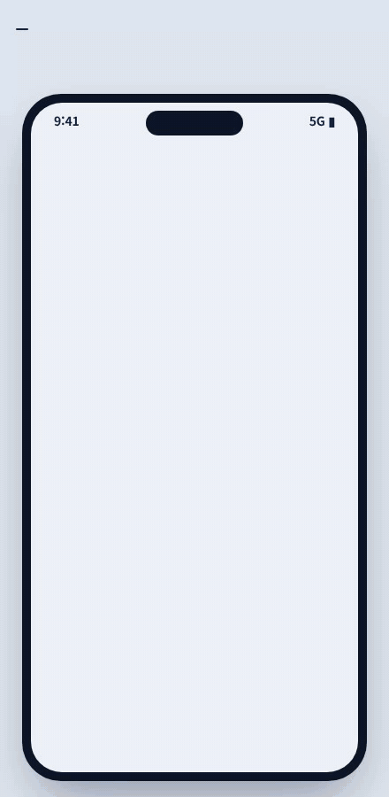

### 9위. 사전 위임장, 알아서 연장
들어가며 탭 한 번으로 연장을 맡겨 두면, 끝나기 전에 규칙이 확인하고 멈출 시간 2분을 준 뒤 알아서 연장해요.

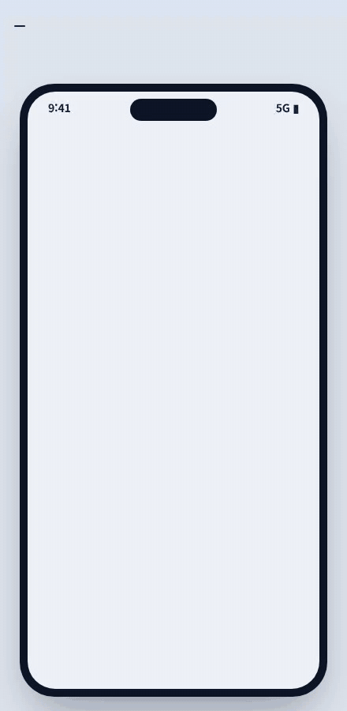

### 10위. 공지가 스스로 일해요
관리자가 공지 한 줄을 쓰면 영향받는 예약이 먼저 보이고, 올리면 해당 학생에게 옆방 대안이 골라진 메일이 가요.

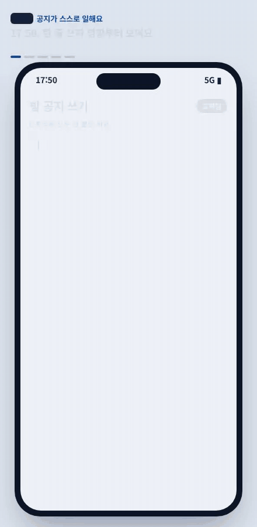

---

- 지금 웹 디자인(색·버튼)으로 만든 시안이고, 입실은 QR이 기본이에요. 사진·영상은 남기지 않아요.
- 의견은 이 글 댓글로 남겨 주세요. 특히 "최종 추천을 할지 말지", "상위 10개 중 더 나은 게 있는지"가 궁금해요.
